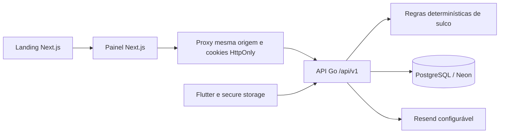
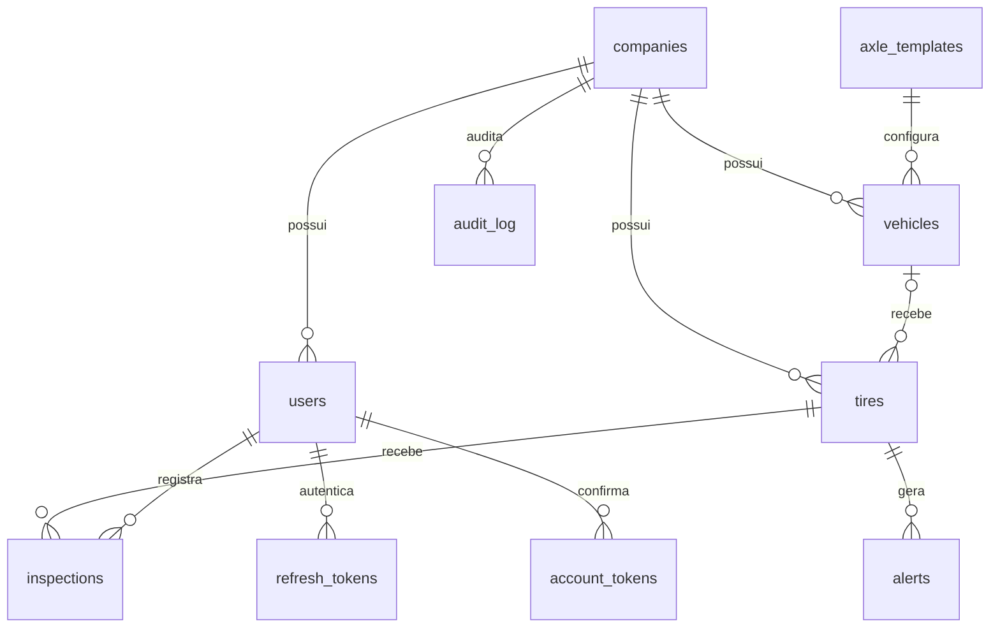

# Arquitetura U0

O modelo alvo completo está em [modelo-de-dados.md](modelo-de-dados.md). As migrations atuais implementam o subconjunto U0 e a inspeção inicial; não criam antecipadamente módulos ainda sem regras implementadas.

Toda transação de negócio usa `set_config('app.company_id', ..., true)`. O escopo expira junto com a transação, evitando vazamento entre conexões do pool. Foreign keys compostas impedem vincular pneu a veículo de outra empresa. Índices únicos impedem duas instalações na mesma posição e duplicação de códigos/placas por empresa. A role runtime não pode ignorar RLS.

Templates são globais e somente leitura no U0. Identidade tem funções restritas para localizar conta e consumir tokens antes de haver tenant autenticado. Tokens de verificação, convite e recuperação têm 24 horas e uso único; refresh tem rotação e hash persistido. Senhas usam Argon2id com salt aleatório.

O web nunca recebe access/refresh no corpo da resposta do proxy. A API não habilita CORS amplo: navegador usa o proxy Next.js, mobile usa HTTP nativo. Mutação pelo proxy exige Origin igual à origem da requisição. Limitação inicial por IP é local ao processo, não substitui proteção distribuída de produção.

O cadastro aceita CNPJ numérico e alfanumérico, mantendo os dois dígitos verificadores numéricos. O cálculo usa os valores ASCII menos 48 conforme o [manual técnico da Receita Federal](https://www.gov.br/receitafederal/pt-br/centrais-de-conteudo/publicacoes/documentos-tecnicos/cnpj/manual-dv-cnpj.pdf). Os testes incluem os exemplos alfanuméricos oficiais.
