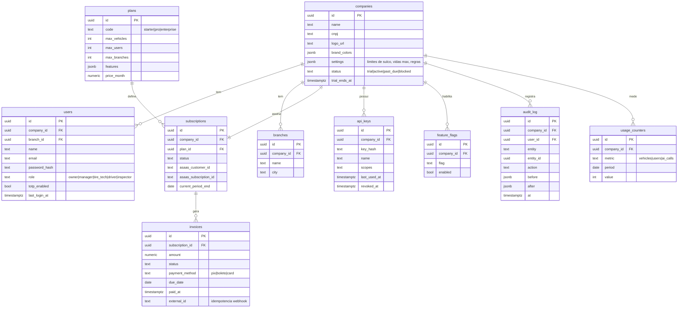
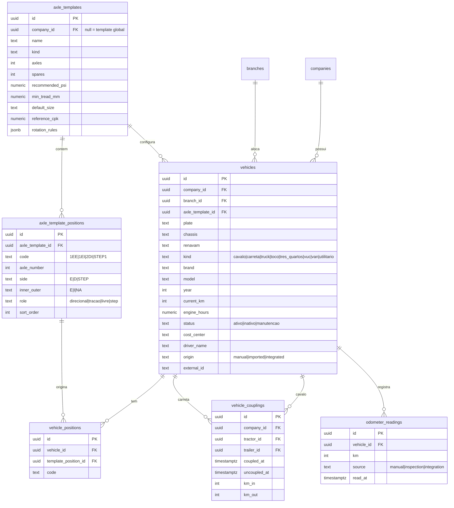
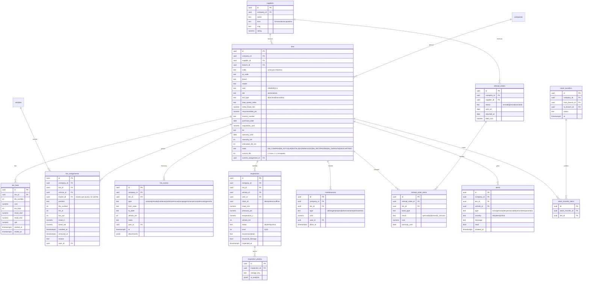
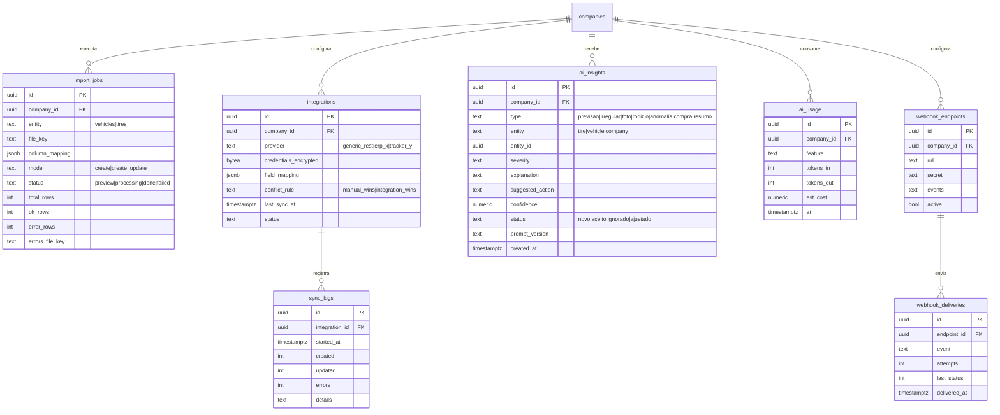

# GeevheitTire: Modelo de Dados (ER em Mermaid)

Convenções: chaves primárias UUID v7; `company_id` em todas as tabelas de negócio (RLS ativo); `created_at`, `updated_at`, `deleted_at` (soft delete) em todas, exceto onde indicado. Valores monetários em `numeric(12,2)`, sulco em `numeric(4,1)` (mm).

## 1. Tenant, usuários e SaaS

## 2. Veículos, eixos e acoplamento

## 3. Pneus, ciclo de vida, passagens, inspeções e custo

## 4. Importação, integrações e IA

## 5. Regras de integridade importantes

1. **Uma passagem aberta por pneu:** índice único parcial em `tire_assignments(tire_id) WHERE removed_at IS NULL`.
2. **Uma posição ocupada por vez:** índice único parcial em `tire_assignments(vehicle_id, position) WHERE removed_at IS NULL`.
3. **Código do pneu único por empresa:** `UNIQUE (company_id, code) WHERE deleted_at IS NULL`.
4. **Placa única por empresa:** `UNIQUE (company_id, plate) WHERE deleted_at IS NULL`.
5. **Odômetro nunca diminui:** validação na aplicação e `CHECK` via trigger em `odometer_readings`; leitura menor gera alerta de inconsistência, não é gravada como km atual.
6. **Transições de estado:** a aplicação valida a tabela de transições; `tire_events` guarda `from_state` e `to_state` para auditoria.
7. **Idempotência offline:** `UNIQUE (company_id, client_id)` em `inspections`.
8. **RLS:** toda tabela com `company_id` usa `USING (company_id = current_setting('app.company_id')::uuid)`; teste automático tenta ler dados de outra empresa e deve falhar.
9. **CPK:** `(acquisition_cost + custo de recapagens + manutenções) / km_total`, calculado por `tire_lives` e acumulado por pneu (job noturno e sob demanda).
10. **Índices recomendados:** `inspections(tire_id, inspected_at desc)`, `tire_events(tire_id, at desc)`, `alerts(company_id, read, created_at desc)`, `tires(company_id, state)`.

## 6. Como pedir as migrations à IA

Cole este arquivo e use: "Gere as migrations SQL (golang-migrate) deste modelo em ordem de dependência, com índices, constraints, RLS e seeds dos templates de eixo. Divida em arquivos por módulo e rode um teste de isolamento entre empresas."